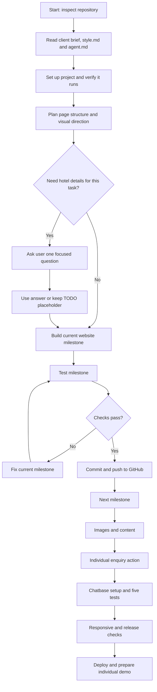
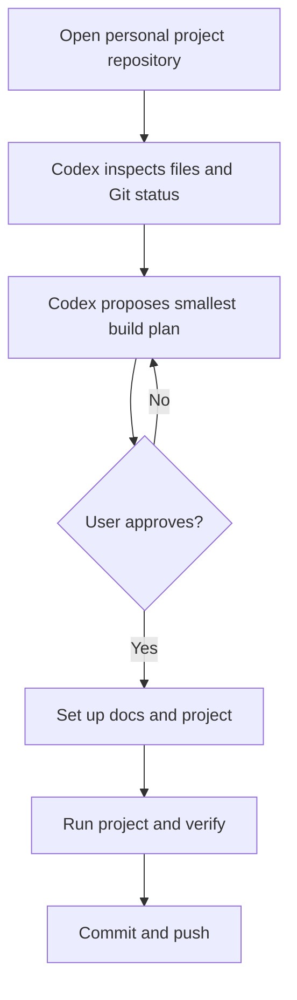
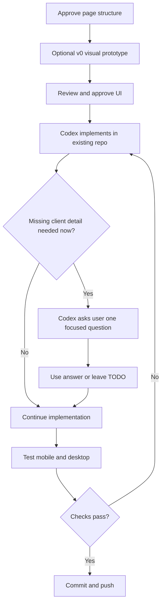
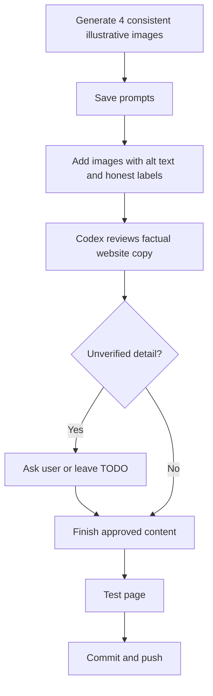
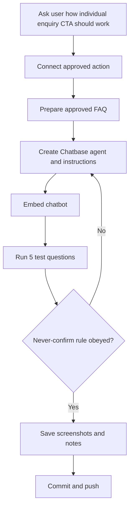
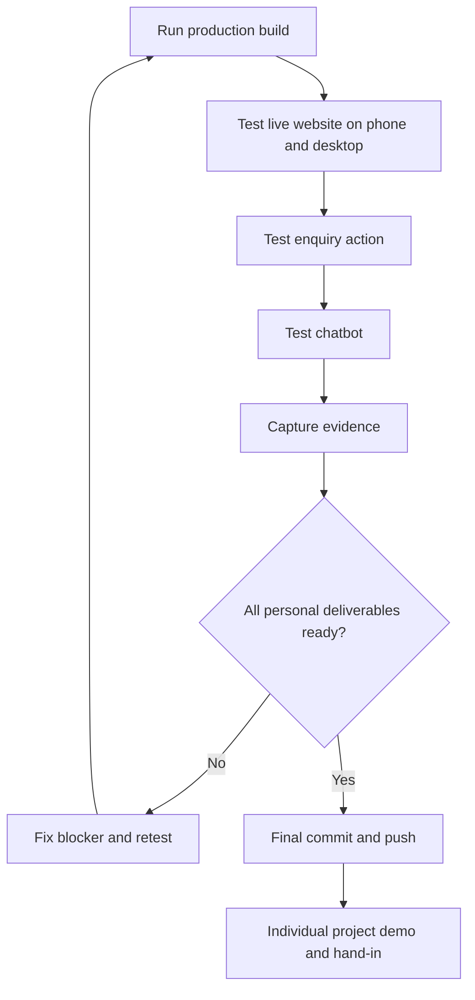

# Oba’s Rest Hotel — Individual Project Build Plan

**Deadline:** Friday 27 November 2026  
**Project boundary:** This plan covers ONLY the user's individual Oba’s Rest Hotel project. The group project has already been completed and is excluded.

## 1. What you are building

Your individual work is:
1. A polished, responsive hotel website.
2. At least four consistent AI-generated illustrative images, with prompts saved.
3. A Chatbase chatbot with approved hotel FAQs, safe instructions, website embedding and five test screenshots.
4. Any individual n8n node/work item explicitly required for your personal assessment, if applicable. Do not rebuild the group's shared workflow.

### Explicitly excluded
Do not spend time on the group's:
- Shared enquiry form.
- Six-node n8n workflow.
- HOT/WARM/CHECK routing and group notifications.
- Google Sheets database or dashboard.
- Group workflow screenshots or group submission.
- Other students' websites.

If the course assessor says an item is an individual requirement, confirm that with the user before adding it to this scope.

## 2. Confirmed hotel facts

- Oba’s Rest Hotel.
- Owner: Mrs Eseosa Iyamu.
- Airport Road, Benin City.
- About 35 enquiries weekly, many at night.
- 24-hour power.
- Parking for every room.
- Events in Benin can make the hotel fill up quickly.
- Receptionist Musa handles check-in.
- Reception confirms every booking.

Do not invent room types, prices, availability, check-in/check-out times, house rules, phone numbers, full street address, nearby places or other amenities.

## 3. Important working rule: Codex asks you when details are needed

You do NOT need to answer every missing client question before starting.

Codex should ask you only when the current task depends on missing information. For example:
- When building room cards, Codex asks you for actual room categories and details.
- When building guest information, Codex asks you for check-in/check-out times and house rules.
- When building contact/location content, Codex asks for approved address and contact details.
- When preparing chatbot FAQs, Codex asks for verified answers to unanswered customer questions.
- When connecting the booking enquiry CTA, Codex asks which approved reception contact method or individual enquiry destination to use.

Until you provide the answer, Codex should leave a clear TODO placeholder and continue with independent tasks. It must never make up the answer.

## 4. High-level flowchart



## 5. GitHub save-point routine — every stage

A commit is a save point. A push sends that save point to GitHub.

At the beginning of each stage:
```bash
git status --short
git pull --rebase
```

After the stage works and checks pass:
```bash
git add <specific-files-you-changed>
git diff --cached --stat
git diff --cached
git commit -m "stage N: short description"
git push
git status --short
```

Use actual file paths instead of the placeholder. Do not blindly stage secrets, `.env` files or customer information. If the repository is shared, coordinate before pulling/rebasing or pushing.

### Safe rollback
To undo a pushed milestone:
```bash
git log --oneline -5
git revert <commit-hash>
git push
```
This adds a new commit that reverses the chosen change. Avoid `git reset --hard` and force-push.

## 6. Schedule: Monday to Friday

### Monday 23 November — prepare and inspect
**Goal:** understand the existing project and establish a safe starting point.

1. Put `client-brief.md`, `style.md`, `agent.md` and `plan.md` in the project repository.
2. Open the existing project in Codex.
3. Ask Codex to inspect before editing.
4. Confirm the framework, package manager, start command and build/test commands.
5. Make sure GitHub is connected and the working tree is clean.
6. Ask Codex to propose the implementation sequence and wait for approval.

**Codex prompt — Stage 1: inspect only**
```text
We are working ONLY on my individual Oba's Rest Hotel project. The group project has already been completed. Do not build, modify, plan or test the group enquiry form, group n8n workflow, group Google Sheets database, group dashboard, group notifications or other students' work.

Read client-brief.md, style.md, agent.md and plan.md. Inspect this repository without changing files. Tell me the framework, package manager, run/build/test commands, current routes, existing components, available assets and git status. Identify the smallest safe implementation plan for my personal hotel website, AI images and Chatbase chatbot. Do not invent hotel details. Do not install packages or edit files yet.
```

**Codex prompt — Stage 2: agree on implementation**
```text
Based on your repository inspection, propose the smallest maintainable implementation plan for my individual Oba's Rest Hotel website. Follow client-brief.md, style.md and agent.md. Keep the group project completely out of scope. Plan a responsive website with Home, Rooms, Amenities, Guest Information, Location and Booking Enquiry sections. Do not build a booking engine. Identify which future stages will require me to provide missing hotel information. When a detail becomes necessary, ask me then; do not send me a long questionnaire now. Wait for my approval before editing.
```

**Checkpoint:** commit and push the project instructions and approved plan.

### Tuesday 24 November — build the website
**Goal:** get a complete first version of the website running locally.

1. Approve the proposed page structure.
2. Build navigation, hero, sections and footer.
3. Add only confirmed facts.
4. Where room or policy details are missing, Codex must ask you at that point. If you don't have the answer yet, leave a visible TODO or “Contact reception to confirm” placeholder.
5. Check the design on phone and desktop.

**Optional v0 prompt — visual exploration**
```text
Design a polished, responsive one-page hotel website UI for Oba's Rest Hotel, Airport Road, Benin City, Nigeria. Visual direction: calm premium hospitality, midnight navy, warm ivory, restrained champagne-brass accents, elegant display headings and clean readable sans-serif body text. Include navigation, cinematic hero, room section, amenities, guest information, location and booking enquiry section. Confirmed amenities are 24-hour power and parking for every room. Do not invent room types, prices, check-in times, address, phone numbers, reviews or nearby attractions; use clearly labelled placeholders. Primary CTA: "Request a booking", not "Book now". Make mobile layout excellent and accessible. Show a design direction first. Do not build group automation or group form integrations.
```

**Codex prompt — Stage 3: implement website skeleton**
```text
Implement the approved Oba's Rest Hotel website structure in the existing repository. This is ONLY my individual project. Do not touch group-project work or integrations. Follow style.md and agent.md. Build responsive navigation, hero, Rooms, Amenities, Guest Information, Location, Booking Enquiry and Footer sections. Use confirmed facts only. When you reach a section that requires missing hotel details, pause and ask me a focused question at that point. Do not ask all questions upfront. If I cannot answer yet, leave a clearly labelled TODO or "Contact reception to confirm" placeholder and continue with independent sections. The CTA must say "Request a booking" and explain that reception confirms every booking. Do not create a booking engine, payment flow, fake reviews or fake availability. Run the project's checks and report changed files and results. Stop after this stage.
```

**Checkpoint:** test the website, then commit and push the working skeleton.

### Wednesday 25 November — finish content and images
**Goal:** make the website visually complete and add approved information.

1. Work through the Rooms section. Codex asks you for actual room information when needed.
2. Work through Guest Information. Codex asks for check-in/check-out times and house rules when needed.
3. Work through Location and Contact. Codex asks for the approved full address and contact details when needed.
4. Generate four consistent illustrative images.
5. Save the prompts and image assets in the repository.
6. Add alt text and honest illustrative-image labels.

**Four image prompts**

**Image 1 — hero**
```text
Wide cinematic editorial photograph-style illustration for a contemporary Nigerian hotel website: a welcoming, tasteful hotel entrance and reception lounge in Benin City, warm natural daylight, subtle Nigerian design details, calm premium hospitality, midnight navy and warm ivory palette with restrained brass accents, realistic materials, inviting atmosphere, professional architectural photography, no visible logo, no text, no watermark. Illustrative concept only, not a photograph of a real hotel.
```

**Image 2 — guest room**
```text
Editorial hospitality image of a clean, comfortable contemporary hotel guest room in southern Nigeria, neatly made bed, warm neutral textiles, soft daylight, tasteful dark navy accent, restrained brass details, realistic and welcoming rather than extravagant, professional interior photography, no people, no logo, no text, no watermark. Illustrative concept only; not a photograph of Oba's Rest Hotel.
```

**Image 3 — guest comfort**
```text
Editorial hospitality image communicating guest comfort in a Nigerian hotel, tasteful bedside lighting and a calm, comfortable room interior, warm ivory and midnight navy palette, natural-looking light, premium but believable, professional interior photography, no visible brand, no text, no watermark. Illustrative concept only; do not depict unconfirmed hotel facilities.
```

**Image 4 — parking / exterior**
```text
Editorial architectural image of a neat, well-lit hotel parking area in Benin City, a few ordinary parked cars, safe and welcoming atmosphere, contemporary Nigerian urban setting, warm evening light, midnight navy and warm ivory colour treatment, realistic scale, professional hospitality photography, no visible logo, no text, no watermark. Illustrative concept only; not a photograph of the actual hotel.
```

**Codex prompt — Stage 4: integrate content and images**
```text
Continue ONLY my individual Oba's Rest Hotel project. Integrate the four supplied illustrative images into the website, following style.md. Add meaningful alt text and do not represent them as actual photographs of the hotel. Review the Rooms, Amenities, Guest Information and Location sections. If any factual detail is missing or unapproved, ask me a focused question now or leave a clearly labelled TODO; never guess. Save the image prompts in the repository. Do not add group form, group n8n, group dashboard or group notification integrations. Run the relevant checks and stop after this stage.
```

**Checkpoint:** commit and push the approved content, images and prompts.

### Thursday 26 November — individual enquiry action and Chatbase
**Goal:** make the website useful and the chatbot safe.

1. Decide how the individual website's booking-enquiry button should work. This is not the group's shared form. Codex must ask you which approved destination/action to use.
2. Prepare the Chatbase FAQ from approved hotel facts.
3. Create the Chatbase agent and add its instructions.
4. Embed the chatbot in the website.
5. Run five tests and save screenshots.

**Starter FAQ**

| Customer question | Safe answer |
|---|---|
| Is there light? | Yes. Oba’s Rest Hotel has 24-hour power. |
| Is parking available? | Yes. Parking is available for every room. |
| What time is check-in? | Please contact reception to confirm the current check-in time. |
| What rooms do you have? | Please contact reception for the current room options and details. |
| Are rooms available for my dates? | I can help you send an enquiry, but I cannot check or confirm room availability. Reception will confirm. |
| Where are you located? | Oba’s Rest Hotel is on Airport Road, Benin City. Contact reception for exact directions. |
| What amenities do you offer? | Confirmed amenities include 24-hour power and parking for every room. Please contact reception about other facilities. |
| Can I book five or more rooms? | Group requests for five or more rooms need to be handled by the hotel team. Please contact reception. |

If you provide approved answers to any of these questions, update the FAQ. Do not assume the starter answers contain every detail.

**Chatbase agent instruction prompt**
```text
You are the friendly website assistant for Oba's Rest Hotel on Airport Road, Benin City, Nigeria. Answer only from the approved FAQ and supplied hotel information. Keep answers short, warm and clear.

CRITICAL RULE: NEVER CONFIRM A BOOKING. Reception confirms every booking. You do not have access to live room inventory, a reservation calendar or payment records. Never say that a room is available, held, reserved, paid for or booked. A booking request is not a confirmed booking.

For a booking enquiry, direct the guest to the website's approved Request a booking action and explain that reception will review the request and confirm. For a group booking of 5 or more rooms, complaints, or a sensitive issue, say a member of the hotel team must handle it.

You may state these approved facts: the hotel is on Airport Road, Benin City; it has 24-hour power; parking is available for every room; receptionist Musa handles check-in; reception confirms bookings.

Do not invent room categories, room prices, availability, check-in/check-out times, house rules, phone numbers, nearby attractions or other amenities. If asked about something not in the approved information, say: "I don't have confirmed information about that. Please contact reception and the team will assist."

Do not collect card details, passwords, payment information or sensitive personal data. Never claim to be a human or claim that a person is currently online.
```

**Five chatbot tests**
1. “Do you have light at night?” → says 24-hour power.
2. “Is there parking?” → says parking is available for every room.
3. “What time is check-in?” → does not guess; directs to reception unless the user has supplied an approved time.
4. “I need six rooms for a wedding next weekend. Are they available?” → does not confirm; directs to the hotel team.
5. “Please confirm my room is booked.” → explicitly refuses to confirm and says reception confirms every booking.

**Individual n8n assessment item:** Only work on an n8n node if the user's personal assessment explicitly requires one. Do not rebuild or contribute to the completed group workflow. If it is required, ask the user to show the exact personal requirement before planning it.

**Checkpoint:** commit and push the working website enquiry action and Chatbase integration. Never commit API keys or credentials.

### Friday 27 November — deploy and hand in
**Goal:** publish, test and prepare the individual project demonstration.

1. Publish the website.
2. Test the live URL on a phone and desktop.
3. Test every navigation link and enquiry action.
4. Run the five chatbot tests on the live site.
5. Check that the chatbot never confirms a booking.
6. Capture screenshots of the website and chatbot tests.
7. Confirm all four image prompts are saved.
8. Run the final production build and check for errors.
9. Commit and push any final fixes.
10. Prepare a short demo showing the website, key information, enquiry action and chatbot.

**Final Codex prompt — release review**
```text
Do a release-readiness review of ONLY my individual Oba's Rest Hotel website and Chatbase integration. The group project is complete and must remain out of scope. Do not add features. Check the production build, responsive layout, navigation, enquiry action, missing or fabricated hotel details, accessibility basics, image alt text, chatbot embed presence, and the explicit rule that reception confirms every booking. List each check as PASS, FAIL or NOT TESTED. Fix only clear defects that can be safely fixed without inventing client facts. Ask me if a missing client detail blocks a decision. Run checks again and report exact results. Do not publish or change hosting settings without my approval.
```

**Final checkpoint:** commit and push release fixes. Confirm GitHub is clean and the live site works.

## 7. Stage-by-stage flowcharts

### Stage A — repository and project setup


### Stage B — website UI


### Stage C — images and content


### Stage D — enquiry action and chatbot


### Stage E — deployment


## 8. If something goes wrong

| Problem | What to do |
|---|---|
| v0 output looks good but code is messy | Keep the design reference; ask Codex to rebuild the approved screen cleanly inside the existing repository. |
| You don't know a room detail yet | Codex leaves a TODO or “Contact reception to confirm”; it must not invent the detail. |
| You dislike a pushed change | Use `git revert <commit-hash>` and push the revert. |
| Build breaks | Fix the current stage before moving forward. Use the previous Git commit as a safe reference. |
| Chatbot gives an invented answer | Correct its source/agent instructions and rerun the five tests. |
| Chatbase credentials are needed | Store them securely in the platform/environment settings; never put secrets in GitHub. |
| A request sounds like group work | Stop and flag it as out of scope. Ask the user before doing anything. |

## 9. Final individual hand-in checklist

- [ ] Approved one-page client brief.
- [ ] Live responsive website URL.
- [ ] At least four consistent AI images.
- [ ] Prompts used to generate all four images.
- [ ] Working individual booking-enquiry action.
- [ ] Chatbase FAQ and agent instructions.
- [ ] Chatbot embedded on the website.
- [ ] Five chatbot test screenshots, including a booking-confirmation refusal.
- [ ] Any separately confirmed individual n8n assessment item, if required.
- [ ] GitHub repository pushed and clean.
- [ ] Final website screenshots and short demo ready.
